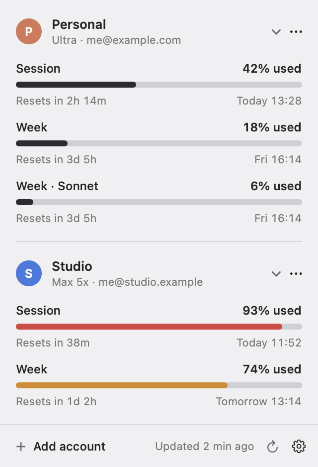

# Claude Limits

A macOS menu bar app that shows the session (5-hour) and weekly usage of up to 10 Claude accounts, and when each one resets.

Unofficial. Not affiliated with or endorsed by Anthropic.

<picture>
  <source media="(prefers-color-scheme: dark)" srcset="docs/dropdown-dark.png">
  
</picture>

## Features

- **Several accounts at once.** Each account signs in through its own small claude.ai window with its own cookies, so logins never mix.
- **The menu bar at a glance.** One or two accounts show as percentages. From three accounts on, each account gets a small vertical bar, in dropdown order.
- **Exact resets.** Every limit shows a countdown and the time it resets, including per-model weekly limits.
- **Ultra accounts without a session limit** show their weekly usage in the menu bar instead.
- Collapse accounts you don't need to see. Refreshes every 5 minutes (2–15 is configurable), when the dropdown opens, after the Mac wakes, and just after a limit resets.

## Install

Download **[Claude-Limits.dmg](https://github.com/vdszds/claude-limits/releases/latest/download/Claude-Limits.dmg)**, open it and drag Claude Limits to Applications. Or use Homebrew:

```sh
brew install --cask vdszds/tap/claude-limits
```

Requires macOS 14 or later, on Apple silicon or Intel. The app is signed and notarized by Apple.

## Build from source

```sh
./build.sh           # builds build/Claude Limits.app
./build.sh install   # copies it to /Applications and launches it
```

Requires Xcode's Swift toolchain.

## How it works

- **Add account** opens a small claude.ai window with its own cookie jar (`WKWebsiteDataStore(forIdentifier:)`). Sign in with Google, Apple or email. To use an emailed sign-in link, paste it into the address field.
- Usage comes from `claude.ai/api/organizations/{org}/usage`, the same data as Settings → Usage. It's an undocumented endpoint, so the parser reads both the older `five_hour` / `seven_day` fields and the newer `limits` array, and it may break when claude.ai changes.
- If claude.ai shows a Cloudflare check, **Open** shows the account's window so the check can pass. The app refreshes when you close it.

## Privacy

- The app only talks to claude.ai. The sign-in window is a small browser, so it also opens Google or Apple if you sign in with them. There are no analytics and no other servers.
- Cookies live in `~/Library/WebKit/com.vzdesenko.Limits/`. Account names and settings live in `UserDefaults` (`com.vzdesenko.Limits`). Removing an account deletes its cookies.

## Development

`Limits --snapshot <dir>` renders the dropdown and the menu bar bars with sample data to PNGs, for design review. `Limits --demo` runs the menu bar item with six sample accounts. The binary is at `.build/release/Limits` after `./build.sh`.

`./release.sh 1.2.0` publishes a release: it builds for both architectures, signs, notarizes, uploads `Claude-Limits.dmg` to GitHub Releases and updates the Homebrew cask. The comment at the top of the script lists what it needs.

## License

[MIT](LICENSE)
